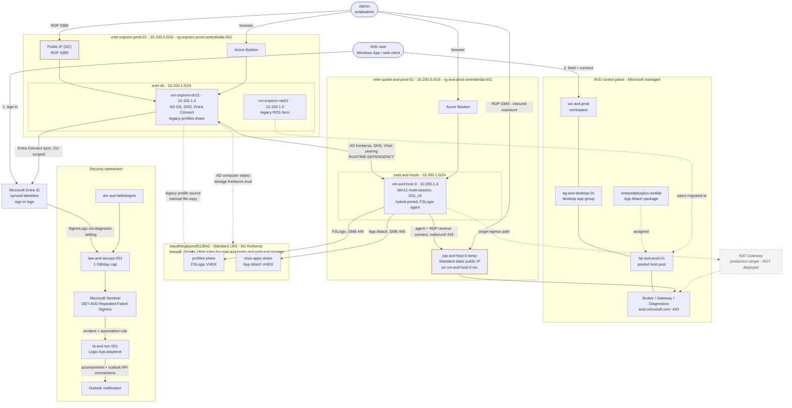

# azure-avd-rds-migration

> **RDS → Hybrid Azure Virtual Desktop → Cloud-Native AVD Identity Modernization Lab**

A simulated legacy Remote Desktop Services (RDS) environment is migrated to Azure Virtual Desktop (AVD) with hybrid Active Directory, Azure Files + AD Kerberos + FSLogix profile containers, MSIX App Attach, Conditional Access, Microsoft Sentinel/SOAR, and a planned transition toward an Entra-only AVD deployment.

Built primarily with **PowerShell**, **Azure CLI**, **Bicep** and **Git Bash**.

> **Status:** **Part 1 Complete** (Phases 1–8). 

> **Status:** **Part 2 Planned** — Cloud-native identity modernization path (Phases 9–14).
---
## Implementation Phases

| Phase | Topic | Status | Codes/Notes |
|---|---|---|---|
| **[01](docs/phase-1-onprem-rds-baseline/README.md)** | **onprem-rds-baseline** | **Done** | `HTTP 403.SSL` `0x3` `DCPromo.General.77`  |
| **[02](docs/phase-2-landingzone-networking/README.md)** | **landingzone-networking** | **Done** | `443` `deny` `allow`  |
| **[03](docs/phase-3-hybrid-identity/README.md)** | **hybrid-identity** | **Done** |     `SCP` `device options` `80230405`  |
| **[04](docs/phase-4-azure-files-fslogix/README.md)** | **azure-Files-FSLogix** | **Done** | `SMB 445` `ACL/RBAC` `Firewall deny/allow` `System Error 5`  |
| **[05](docs/phase-5-avd-hostpool/README.md)** | **avd-hostpool** | **Done** | `Geneva` needs `assistance` `HTTP 401`, `Failed(3) code 2` `404`   |
| **[06](docs/phase-6-migration-cutover/README.md)** | **migration-cutover** | **Done** | `0x00000001` (*Incorrect function*); `409` `AVD mslearn best practices` `dcregcmd` |
| **[07](docs/phase-7-msix-app-attach/README.md)** | **msix-app-attach** | **Done** | CIM `0x80070057` (*Invalid parameter*) `298`; `.VHDX fallback validated` `klist` `Restart-Service RDAgent & RDAgentBootloader` `path denied` `NTUSER.DAT` `RDP Properties edits in Session host on Azure portal` `Test-Path` `$LASTEXITCODE` `Domain Policy vs DC in gpmc.msc` |
| **[08](docs/phase-8-p2-secops-governance/README.md)** | **p2-secops-governance** | **Done** | `MFA` `50126` `50089` `scheduled query rule invalid` ARM/API `401` / `400` issues investigated |
| **09** | cloud-native-identity-&-dependency-preflight | *Planned* | Part 2 — Cloud-Native Modernization |
| **10** | azure-files-entra-kerberos-migration | *Planned* | Part 2 — Cloud-Native Modernization |
| **11** | entra-only-AVD-FSLogix-cutover | *Planned* | Part 2 — Cloud-Native Modernization |
| **12** | application-&-cloud-native-runtime-validation | *Planned* | Part 2 — Cloud-Native Modernization |
| **13** | domain-controller-OFF-test | *Planned* | Part 2 — Cloud-Native Modernization |
| **14** | ad-retirement-&-final-cloud-native-validation | *Planned* | Part 2 — Cloud-Native Modernization |
| **[15](docs/phase-15-troubleshooting/README.md)** | troubleshooting-&-cost-governance | *Planned* | Part 1 `DONE` Part 2 `WIP` |


## Key Engineering Investigations

Rather than assuming cloud and desktop components work out of the box, several implementation paths were thoroughly tested, isolated, and debugged in real time:

- **FSLogix Profile Migration:** Encountered error `0x00000001` (*Incorrect function*); resolved through registry hive load/unload validation, `NTUSER.DAT` access isolation, and container storage path adjustments.
- **MSIX CIM / App Attach Troubleshooting:** Native CIM mounting failed with driver errors `0x80070057` (`ERROR_INVALID_PARAMETER`) and semaphore lock issues (`Error 298`).
- **Storage & Driver Isolation:** Evaluated CIM mounting across driver, Windows OS version, storage permissions, and mount-path parameters before executing a fallback.
- **Fallback Package Delivery:** A VHDX-based MSIX package was created, digitally signed using `SignTool 10.0.18362.0`, uploaded to Azure Files, hash-verified, and successfully registered with AVD App Attach (`Import-AzWvdAppAttachPackageInfo` / `New-AzWvdAppAttachPackage`).
- **SOAR Payload Fixes:** Debugged API `400 Bad Request` and `401 Unauthorized` errors in Azure Logic Apps by building robust expression parsing for incident ARM IDs (`coalesce()`) and linking managed identity permissions across Sentinel workspaces.
- **Telemetry UI Propagation Delays:** Bypassed UI caching delays in the Defender / Sentinel portals by verifying raw telemetry ingestion via KQL against `SigninLogs` and deploying rules directly through PowerShell.

## Part 1 Outcome


```text
Legacy RDS
  │
  └──► AD DS / Hybrid Identity
        │
        └──► Azure Virtual Desktop
              │
              └──► Azure Files + FSLogix
                    │
                    └──► MSIX App Attach
                          │
                          └──► Conditional Access / MFA
                                │
                                └──► Microsoft Sentinel
                                      │
                                      └──► SOAR / Logic App
```
##
## What Works

- **Legacy RDS Migration:** Legacy RDS workload migrated to Azure Virtual Desktop.
- **Hybrid AD DS Authentication:** Domain-joined AVD session host authenticates against simulated on-premises AD DS (`vm-onprem-dc01`).
- **Profile Migration:** Legacy RDS user profile migrated into an FSLogix profile container stored on Azure Files.
- **Application Delivery:** Application delivered through AVD App Attach using a VHDX-packaged MSIX application.
- **Identity Security:** Conditional Access and MFA integrated into the AVD identity flow.
- **SIEM Detection:** Microsoft Sentinel detects repeated failed sign-ins using custom KQL and automatically creates security incidents.
- **SOAR Automation:** Sentinel automation triggers an Azure Logic App workflow that processes account entities and sends notification emails.
- **Workload Continuity:** Legacy RDS can be retired while the AVD workload remains operational.
- **Cloud-Native Transition:** Part 2 will test whether AVD can operate independently of the on-premises domain controller.

---

## Architecture
# As-built architecture: Part 1 (hybrid, Phases 1-8)





**Legend:** dashed grey node = target, not deployed. Orange nodes = public IPs
(inbound RDP exposure). The DC-to-host arrow is a runtime dependency: with the DC
off, new AVD sign-ins fail (Phase 15 log, Issue 11).

Region: Central India. Resource names match the Azure Resource Visualizer export


## **Part 1 Summary:** 

**Demonstrates that the AVD workload can operate after the legacy RDS session host is retired. It proves hybrid stability and SecOps automation without claiming independence from Active Directory.**

## Part 2 — Cloud-Native Direction (PLANNED) 

```text
Hybrid AVD
  │
  └──► Entra Kerberos Pilot
        │
        └──► Entra-Only AVD Host
              │
              └──► FSLogix + Azure Files
                    │
                    └──► MSIX Revalidation
                          │
                          └──► Domain Controller OFF Test
                                │
                                └──► Cloud-Native AVD Validation
```

The objective of Part 2 is to test and validate whether AVD can operate completely independent of the on-premises Domain Controller (`vm-onprem-dc01`).

## Known Limitations & Design Choices

- **AD DS Dependency:** The current Part 1 AVD environment remains dependent on the simulated AD DS environment for Kerberos authentication.
- **App Attach Format:** VHDX-based App Attach was selected as the validated fallback over CIM due to platform and driver errors encountered during the lab.
- **Management Access:** Temporary public IP access was utilized during specific setup windows for administration. Production environments should enforce private administrative access via **Azure Bastion** or equivalent controls.
- **Resource Management:** Lab components were provisioned for required validation windows and deallocated/cleaned up to minimize cloud costs.

## Cost Notes

This is a learning and engineering validation lab rather than a production cost model.

Actual production costs depend on resource runtime, Azure Files storage tier/capacity, Sentinel log ingestion volume, NAT/Public IP usage, and licensing.

Resources were deployed strictly for test windows and deallocated where possible.

## Repository Layout

```text
azure-avd-rds-migration/
│
├── docs/
│   ├── phase-01-ad-rds-foundation/
│   ├── phase-02-azure-networking/
│   ├── phase-03-avd-deployment/
│   ├── phase-04-azure-files-fslogix/
│   ├── phase-05-profile-migration/
│   ├── phase-06-msix-app-attach/
│   ├── phase-07-identity-conditional-access/
│   ├── phase-08-sentinel-soar/
│   └── phase-09-to-15-part2-cloud-native/
│
├── images/
│   ├── phase-01/
│   ├── phase-06/
│   └── phase-08/
│
├── scripts/
│   ├── powershell/
│   └── bash/
│
└── README.md
```

Each phase directory contains its own dedicated implementation notes, CLI/PowerShell execution commands, screenshot evidence, KQL queries, and root-cause troubleshooting logs.

## Conclusion & Engineering Philosophy

The repository documents both the as-built implementation and the planned next architecture.

Results are recorded as **validated, failed, workaround, or planned** rather than presenting the original design as if every component worked exactly as intended.

When portal dashboards experience propagation delays, system verification relies on low-level evidence:

> ***Trust the logs. Trust KQL. Trust PowerShell. Follow the evidence.***

