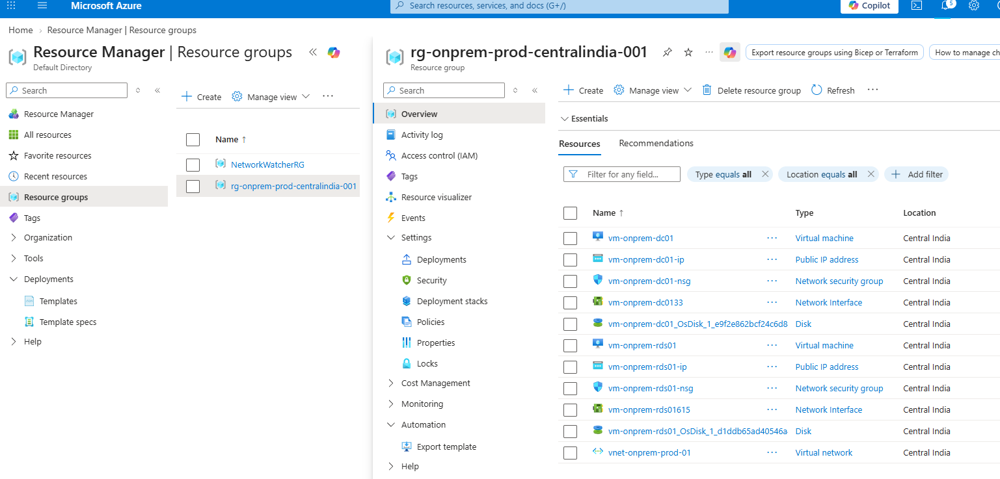
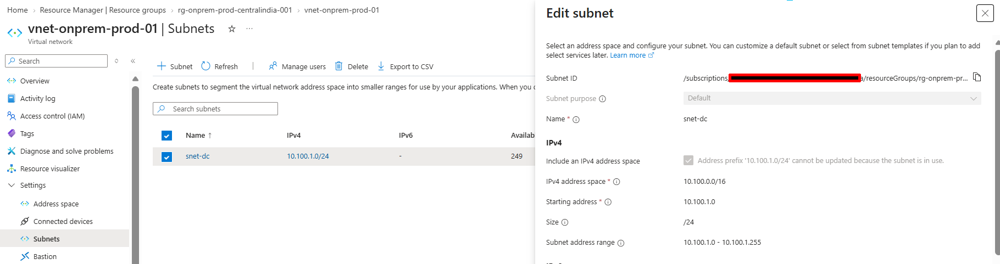
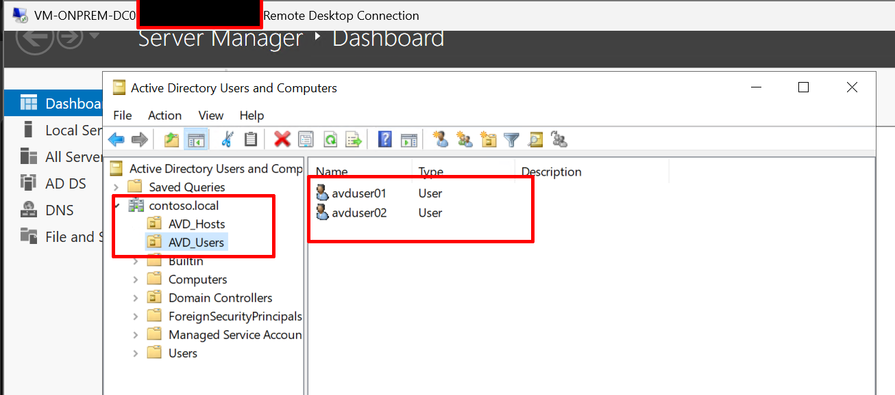
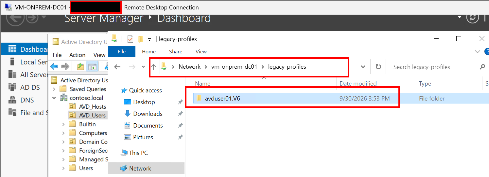
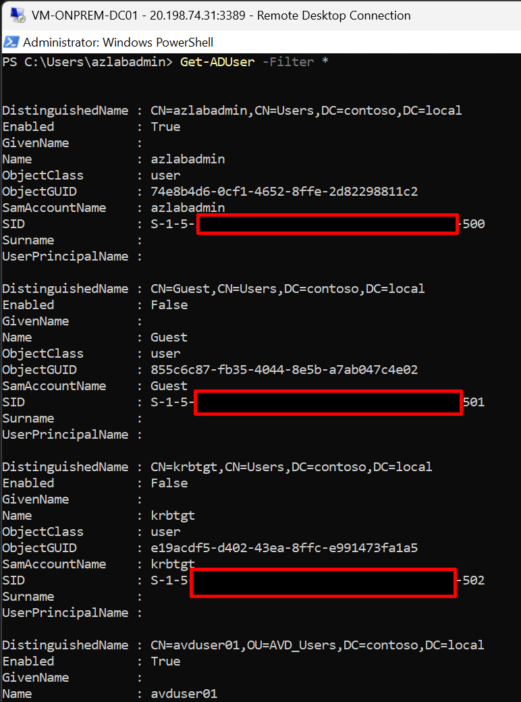

# Phase 1: Simulated on-premises AD DS and legacy RDS

## Objective

Build the legacy environment that the rest of the project migrates away from: an Active
Directory domain with DNS and a file server holding roaming profiles, plus a separate RDS
server running Gateway, Connection Broker and Session Host. This is the "before" state.

> This is the legacy environment we are migrating.

## Prerequisites

- Azure subscription, Azure CLI or Az PowerShell signed in, region `centralindia`.
- Windows Server 2022 image access.
- Git Bash open in the repo root; commands recorded in `scripts/phase-1.ps1`.

## Resources

| Resource | Name | Notes |
|---|---|---|
| Resource group | rg-onprem-prod-centralindia-001 | |
| VNet | vnet-onprem-prod-01 | 10.100.0.0/16, subnet snet-dc 10.100.1.0/24 |
| VM (DC, file server) | vm-onprem-dc01 | Standard_B2s, static IP 10.100.1.4 |
| VM (RDS roles) | vm-onprem-rds01 | Standard_B2s, static IP 10.100.1.5 |
| Domain | contoso.local | |

## Steps

1. Create the resource group, VNet and subnet.
2. Deploy `vm-onprem-dc01` with a static private IP. Set the VNet DNS server to 10.100.1.4
   after the domain controller is promoted.
3. Install AD DS and promote to a new forest `contoso.local`.
4. Create OUs `AVD_Users` and `AVD_Hosts`, and users `avduser01`, `avduser02`.
5. On the DC, create a share `\\vm-onprem-dc01\legacy-profiles` and set it as the roaming
   profile path for the test users.
6. Deploy `vm-onprem-rds01`, join it to `contoso.local`.
7. Install RDS roles (Gateway, Connection Broker, Session Host) with a self-signed
   certificate.
8. Sign in as `avduser01` through RDS, create recognisable test data (files, a desktop
   change) so the profile can be verified after migration.

## Verification

```powershell
Get-ADUser -Filter * -SearchBase "OU=AVD_Users,DC=contoso,DC=local"
Get-RDServer -ConnectionBroker vm-onprem-rds01.contoso.local
Test-Path "\\vm-onprem-dc01\legacy-profiles\avduser01.V2"
```

- `Get-ADUser -Filter *` lists both test users.
- `avduser01` signs in through the RDS farm and a roaming profile folder appears on the share.
- `Get-RDServer` shows all three roles (Gateway, Broker, Session Host).

## Evidence checklist 

- [x] 
  
- [x] 
  
- [x] 
   
- [x] 
  
- [x] 
   
- [x] 
  
- [x]  


