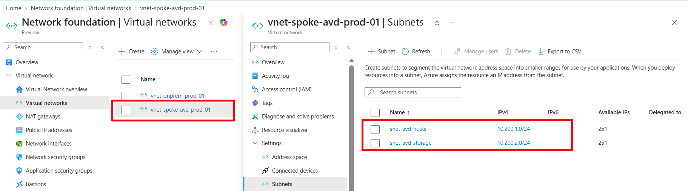
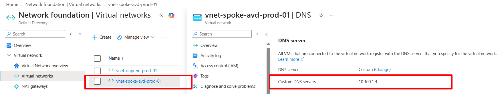

# Phase 2: AVD landing zone, VNet peering, DNS

## Objective

Create the Azure spoke network and connect it to the simulated on-premises network without
a VPN Gateway, so session hosts can resolve and join `contoso.local`.

## Prerequisites

- Phase 1 complete and the domain controller reachable at 10.100.1.4.

## Resources

| Resource | Name | Notes |
|---|---|---|
| Resource group | rg-avd-prod-centralindia-001 | |
| VNet | vnet-spoke-avd-prod-01 | 10.200.0.0/16 |
| Subnet | snet-avd-hosts | 10.200.1.0/24 |
| Subnet | snet-avd-storage | 10.200.2.0/24, `Microsoft.Storage` service endpoint |
| Peering | onprem-to-spoke, spoke-to-onprem | both directions |

## Steps

1. Create the resource group, spoke VNet and both subnets.
2. Add the `Microsoft.Storage` service endpoint to `snet-avd-storage`.
3. Create the two-way peering between `vnet-onprem-prod-01` and `vnet-spoke-avd-prod-01`.
4. Set the spoke VNet custom DNS server to 10.100.1.4.
5. Add NSGs with only the rules needed (domain traffic from the spoke to the DC).


## Verification

```powershell
Get-AzVirtualNetworkPeering -VirtualNetworkName vnet-onprem-prod-01 -ResourceGroupName rg-onprem-prod-centralindia-001
Get-AzVirtualNetworkPeering -VirtualNetworkName vnet-spoke-avd-prod-01 -ResourceGroupName rg-avd-prod-centralindia-001
```

From a test VM in the spoke subnet:
```powershell
Resolve-DnsName contoso.local
Test-NetConnection 10.100.1.4 -Port 389
```

- Peering state is `Connected` on both sides.
- DNS resolves `contoso.local` and LDAP (389) is reachable from the spoke.

## Evidence checklist 

- [x] 
  
- [x] 

- [x] 
  
- [x] 

- [x] 
  
- [x] **[raw output of the DNS resolution and `Test-NetConnection` test](../evidence/resolve-dns.txt)**


