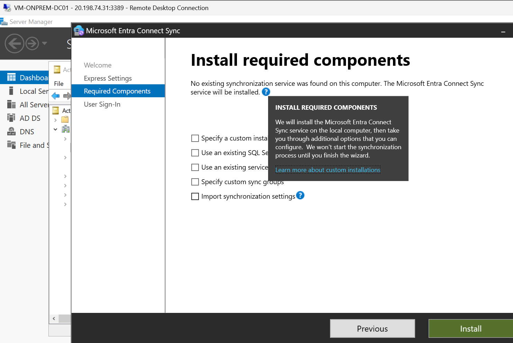
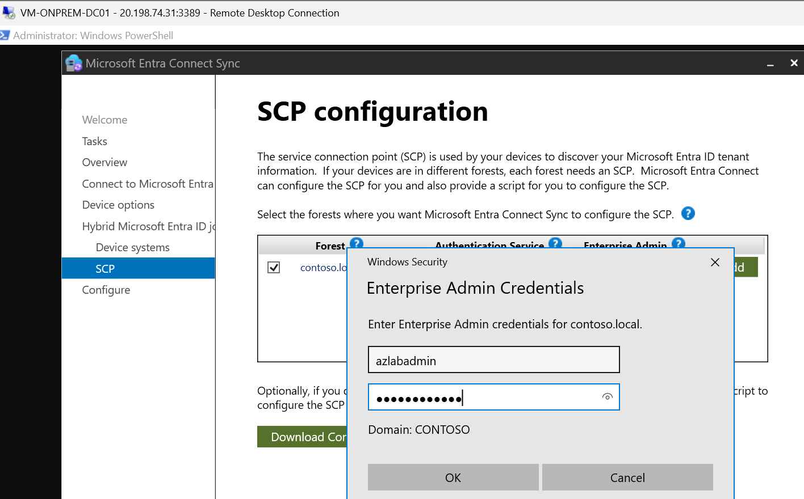
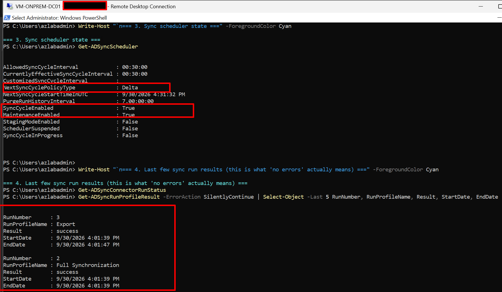
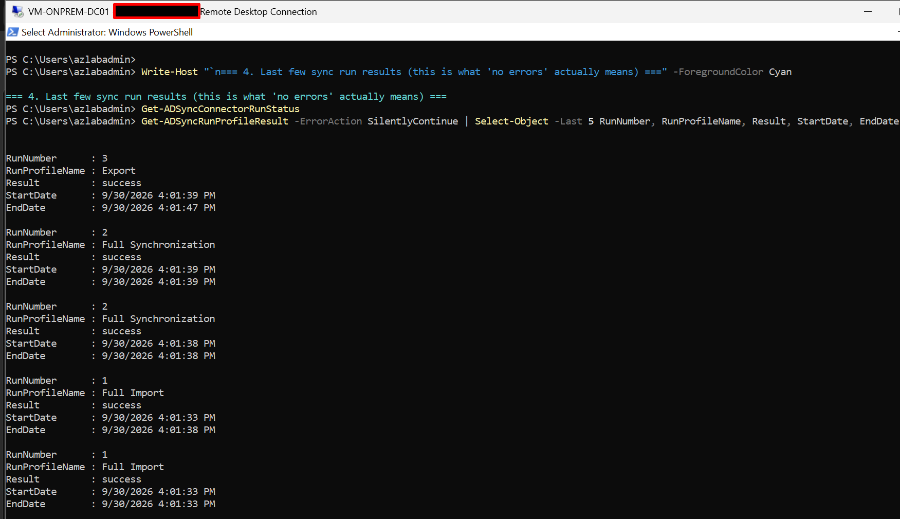

# Phase 3: Hybrid identity with Entra Connect

## Objective

Synchronise `contoso.local` users to Entra ID and configure the device options that hybrid
Entra join needs. Session hosts are hybrid-joined because Azure Files AD Kerberos for
FSLogix depends on the AD-joined path in this lab.

## Prerequisites

- Phases 1 and 2 complete.
- A verified custom domain or the `onmicrosoft.com` UPN suffix plan for synced users.

## Steps

1. Add a UPN suffix in AD if needed and set it on the test users.
2. Install Microsoft Entra Connect on `vm-onprem-dc01`.
3. Choose custom settings (not Express) so device options are available.
4. Enable Password Hash Synchronization.
5. Under device options, configure **hybrid Microsoft Entra join** for domain-joined
   Windows devices and create the Service Connection Point.
6. Scope sync to the `AVD_Users` and `AVD_Hosts` OUs, and to the storage account computer
   object OU created in Phase 4.
7. Confirm synced users in the Entra admin center and assign the licences or roles needed
   for AVD access.


## Verification

```powershell
# On the DC, confirm the SCP exists
Get-ADObject -Filter {objectClass -eq "serviceConnectionPoint"} -SearchBase "CN=Configuration,DC=contoso,DC=local"

# Confirm sync completed without errors
# (Synchronization Service Manager > Operations tab, or:)
Get-ADSyncScheduler
```

- Synced users show "Directory synced: Yes" in the Entra admin center.
- The SCP exists in the configuration naming context.
- Sync cycle completes without errors in Synchronization Service Manager.

## Evidence checklist

- [x] 

- [x] 
   
- [x] 
  
- [x] 
  
- [x] 
  
- [x] **[raw output of the SCP query](../evidence/scp-check.txt)**

