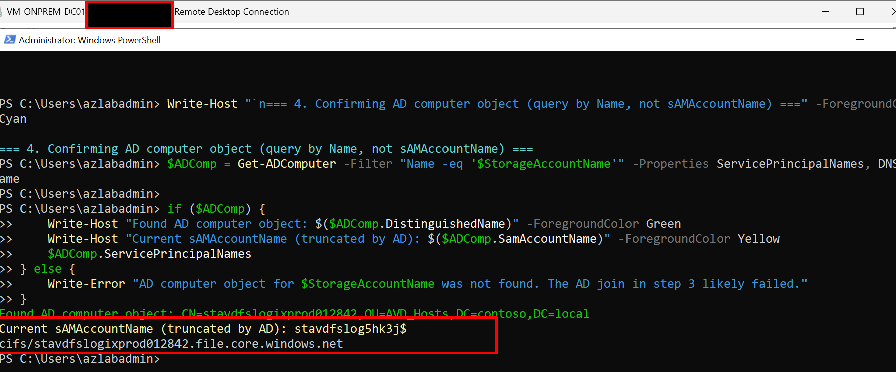
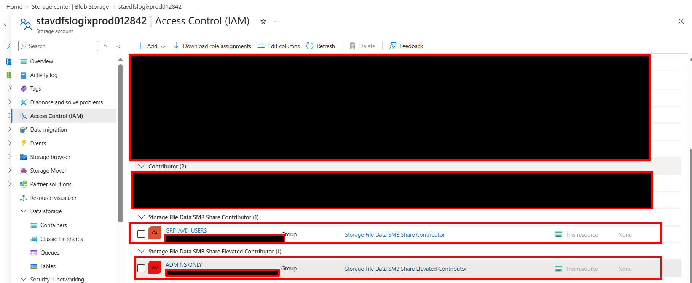
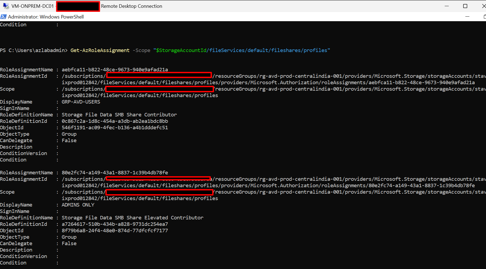
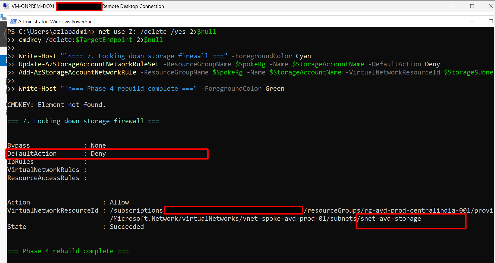

# Phase 4: Azure Files, AD Kerberos, RBAC and NTFS

**Status:** Completed (rebuilt once from a clean teardown after an earlier partial
attempt). Several steps deviated from the original plan — see Deviations below. This
README reflects what was actually run and verified, not the original assumption.

**Est. time:** 45 min planned; actual time including troubleshooting ran significantly
longer across the original attempt, teardown, and rebuild.

## Objective

Replace legacy roaming profile storage with an Azure Files share joined to Active
Directory for Kerberos authentication, ready to hold FSLogix profile containers, plus a
second share for MSIX app attach images.

## Prerequisites

- Phases 1 to 3 complete. The AzFilesHybrid module must run from a **domain-joined**
  machine with rights to create computer objects (`vm-onprem-dc01`).


## Resources

| Resource | Name | Notes |
|---|---|---|
| Storage account | stavdfslogixprod012842 | Standard LRS, `centralindia` (name has a numeric suffix — the original `stavdfslogixprod01` was unavailable) |
| File share | profiles | 100 GB quota, FSLogix containers — **created via portal**, see Deviations |
| File share | msix-apps | 20 GB quota, app attach images — **created via portal**, see Deviations |
| AD computer object | CN=stavdfslogixprod012842 | OU=AVD_Hosts; sAMAccountName truncated to `stavdfslog5hk3j$` by AD's 15-char limit — expected, not an error |
| RBAC | Storage File Data SMB Share Contributor | GRP-AVD-USERS (object ID `546f1191-ac09-4fec-b136-a4b1dddefc51`) on `profiles` |
| RBAC | Storage File Data SMB Share Elevated Contributor | ADMINS ONLY (object ID `8f79b6a8-24f4-48e0-874d-77dfcfcf7177`) on `profiles` |

## Deviations from the original plan

This phase did not go as originally scripted. Documenting the real path rather than
smoothing it over:

1. **First attempt left a stale AD object.** An earlier, incomplete run of
   `Join-AzStorageAccountForAuth` created an AD computer object but didn't fully
   register on the Azure side. Retrying later failed with "An AD object ... already
   exists within AD," which needed `-OverwriteExistingADObject` (not bare `-Force`,
   which only suppresses confirmation prompts and does not resolve an object conflict)
   to fix. See `docs/phase-15-troubleshooting/README.md` for how this was diagnosed.
2. **Full teardown and clean rebuild** was done rather than patching the partial state
   — the AD computer object, Azure role assignments, and the storage account itself
   were all deleted and recreated from scratch. This turned out to be the faster path
   once the partial state was confirmed broken.
3. **`New-AzStorageShare` has no quota parameter on the installed Az.Storage module
   version.** Both `-QuotaGiB` and `-QuotaGB` failed with "parameter cannot be found."
   Confirmed via `Get-Command New-AzStorageShare -Syntax` that no quota parameter
   exists at all on this version — it's not a naming difference, the cmdlet genuinely
   doesn't support it. The correct fix is `Set-AzStorageShareQuota` as a separate step
   (confirmed to exist via `Get-Command -Syntax`), but for this run, **both shares were
   created directly via the Azure Portal** instead, with quota set in the creation
   dialog, to avoid further delay. Full detail in
   `docs/evidence/phase4-quotagb-portal-fallback-note.txt`.

4. **Quota verification after the fact failed with an authentication error** —
   expected, not a new bug: Step 7 locks the storage firewall to `snet-avd-storage`
   only, and the verification was run from `vm-onprem-dc01`, which sits outside that
   subnet. This is the firewall doing exactly what it was configured to do. To verify
   share quota after lockdown, either run the check from a VM inside `snet-avd-storage`
   (e.g. the AVD session host once Phase 5 exists), or temporarily reopen the firewall.

## Steps actually run (PowerShell)

1. Teardown of the partial first attempt (AD computer object, role assignments,
   storage account — full delete).
2. Storage account created via script.
3. **Both file shares created via portal** (see Deviation 3) rather than script.
4. Storage firewall kept open (`DefaultAction: Allow`) during setup — this is required,
   not optional: `vm-onprem-dc01` sits outside `snet-avd-storage`, so AD join and the
   NTFS mount step both need the firewall open to reach the share at all.
5. `Join-AzStorageAccountForAuth` with `-OverwriteExistingADObject`, run from
   `vm-onprem-dc01`. Confirmed via `$sa.AzureFilesIdentityBasedAuth` showing
   `DirectoryServiceOptions: AD`.
6. AD computer object confirmed via `Get-ADComputer -Filter "Name -eq '...'"`
   (queried by Name, not `-Identity`, to avoid the 15-character sAMAccountName
   truncation issue).
7. RBAC: Contributor role to GRP-AVD-USERS, Elevated Contributor role to ADMINS ONLY,
   both on the `profiles` share, both by object ID. Confirmed in the portal's IAM blade.
8. Root NTFS ACLs applied via a one-time storage-key mount (legitimate, narrow use of
   the key for admin bootstrap only — not a substitute for the Kerberos auth already
   confirmed working): `icacls` grants to `CONTOSO\GRP-AVD-USERS` and `CREATOR OWNER`,
   both processed successfully, 0 failures.
9. Storage firewall locked down to `DefaultAction: Deny` with only `snet-avd-storage`
   allowed, as the final step — only after every setup step that needed open access
   had already completed.

## Verification

```powershell
# AD-based auth confirmed active
$sa = Get-AzStorageAccount -ResourceGroupName $SpokeRg -Name $StorageAccountName
$sa.AzureFilesIdentityBasedAuth | Format-List
# Expect: DirectoryServiceOptions : AD, with ActiveDirectoryProperties populated

# AD computer object confirmed (query by Name, not Identity/sAMAccountName)
Get-ADComputer -Filter "Name -eq '$StorageAccountName'" -Properties ServicePrincipalNames

# RBAC confirmed
Get-AzRoleAssignment -Scope "$StorageAccountId/fileServices/default/fileshares/profiles" |
    Select-Object DisplayName, RoleDefinitionName
```

Share quota can only be verified from inside `snet-avd-storage` once the firewall is
locked down (see Deviation 5) — confirm this from the AVD session host in Phase 5, or
via the portal's File shares blade, which isn't subject to the VNet firewall rule the
same way a direct SMB/PowerShell call from an external subnet is.

## Evidence checklist 

- [x]  
  
- [x]  
 
 
- [x] 

- [x] 
  
- [x] 
  
- [x] 
  
- [x] **[raw AD join + computer object confirmation output](../evidence/phase4-ad-join-verification.txt)** 
  
- [x] **[raw icacls output](../evidence/phase4-ntfs-acl-output.txt)**
  
- [x] **[the parameter-gap finding and portal fallback decision](../evidence/phase4-quotagb-portal-fallback-note.txt)**

## Outcome

Phase 4 completed via a clean teardown-and-rebuild after an initial partial attempt.
Two real Az module gaps were found and documented rather than papered over: the
`New-AzStorageShare` quota parameter doesn't exist on the installed module version
(portal used as fallback), and `-OverwriteExistingADObject` (not bare `-Force`) is
required to recover from a stale AD object left by an incomplete prior join. 
