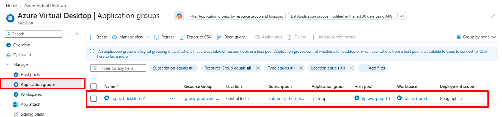
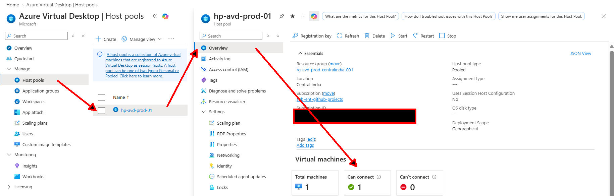
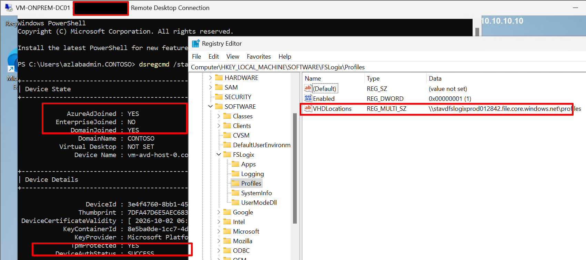
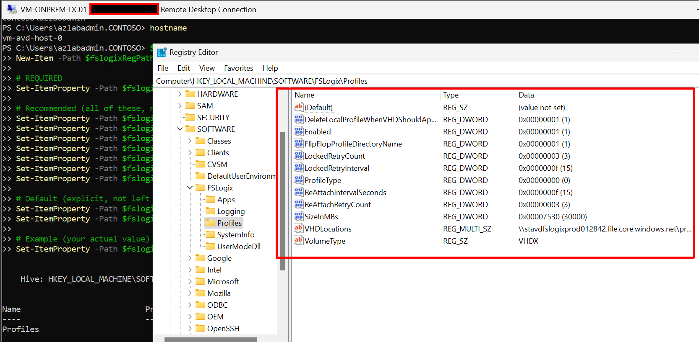
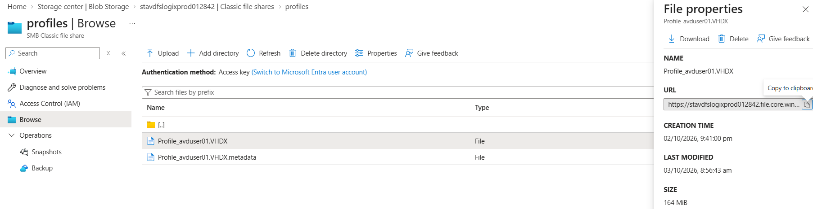
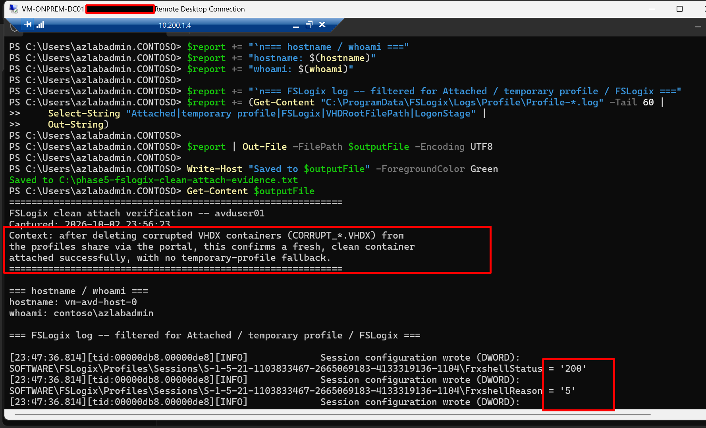
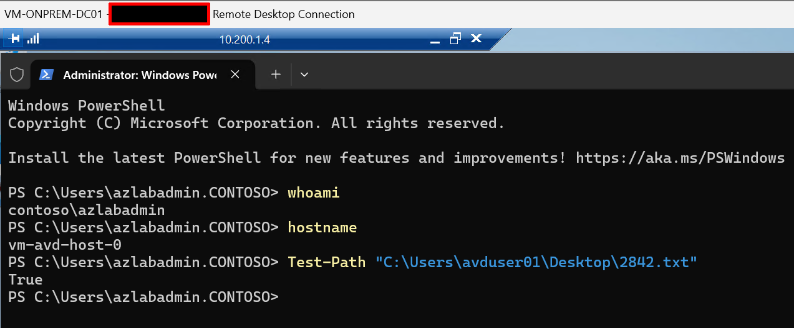

# Phase 5: AVD host pool, hybrid join, FSLogix

**Status:** Completed. This phase ran across multiple sessions (Oct 1 evening through
Oct 3 morning) and surfaced five distinct, real issues — a stuck VM requiring full
redeploy, a missing continuous outbound-internet path, an incomplete initial FSLogix
configuration, a container-naming migration side effect, and corrupted VHDX
containers misdiagnosed once before being correctly identified. Each is documented in
full in `docs/phase-15-troubleshooting/README.md`, Issues 4 through 7. This README
describes the final, working state and the real path taken to get there.


## Objective

Deploy the target AVD environment that replaces the RDS Session Host farm, with
FSLogix profiles correctly configured per Microsoft's documented "Standard" tier,
redirected to Azure Files.

## Prerequisites

- Phases 1 to 4 complete. This phase depends on Phase 4's storage account, AD join,
  and RBAC — nothing here recreates those.

## Resources

| Resource | Name | Notes |
|---|---|---|
| Host pool | hp-avd-prod-01 | Pooled, breadth-first |
| Application group | ag-avd-desktop-01 | Desktop |
| Workspace | ws-avd-prod | |
| Session host | vm-avd-host-0 | Standard_D2s_v5, Windows 11 multi-session, in snet-avd-hosts |
| Public IP | pip-avd-host-0-temp | Kept attached on an ongoing basis — see Deviations |
| AD group | grp-avd-hosts | Session host computer accounts; object ID `d556e518-ee74-4760-911e-1b7390028d9e` |

## Deviations from the original plan

1. **No continuous outbound internet path exists without a public IP.** The project's
   original design assumed session hosts only needed outbound access for one-time
   setup (agent/FSLogix installer downloads). In practice, the AVD agent needs
   **ongoing** access to Microsoft's broker and Geneva monitoring endpoints
   (`*.rdbroker.wvd.microsoft.com`, `*.rddiagnostics.wvd.microsoft.com`, and others).
   Removing the public IP after setup caused the host to show `NeedsAssistance` with
   an explicit Geneva-URL error naming the exact unreachable endpoints. **The public
   IP is being kept attached permanently** as a pragmatic, cost-aware decision — a
   NAT Gateway is the architecturally preferable, more zero-trust-aligned fix
   (centralized egress, no inbound surface) and is planned as a deliberate, separate
   addition to the architecture, not swapped in under time pressure.
2. **First session host deployment reached an unrecoverable stuck state** — portal
   showed "Running" while the host pool reported "Shutdown," and it stopped
   responding to graceful deletion commands. After ruling out Azure resource
   provider registration as a cause, the entire AVD layer was deleted (host pool,
   workspace, app group, VM, NIC, disk, public IP, a stray boot-diagnostics storage
   account) and redeployed clean. Root cause was not fully determined — documented
   honestly as unresolved at the diagnostic level in Phase 10, Issue 4.
3. **FSLogix was initially configured with only `Enabled` and `VHDLocations`**, left
   to its own defaults for everything else. This produced `.vhd` (not `.vhdx`)
   containers in `<SID>_<username>` naming — functional, but not matching Microsoft's
   documented "Standard" configuration tier. The full Standard config (see
   `scripts/phase-5.ps1`, step 6) was applied retroactively, sourced directly from
   [Microsoft Learn's FSLogix configuration examples](https://learn.microsoft.com/en-us/fslogix/concepts-configuration-examples)
   rather than assumed from memory.
4. **Applying `FlipFlopProfileDirectoryName` to an environment with existing
   containers orphaned them**, exactly as Microsoft's own documentation warns ***("Be
   careful when changing this setting in an existing FSLogix environment as it can
   cause users to get new profiles")***. The old SID-first containers for `avduser01`
   and `avduser02` were deleted; `azlabadmin`'s old container was left in place
   (locked by an active process, not worth the time to chase given it's an
   incidental account, not a real test user — see Phase 10, Issue 6).
5. **Both `avduser01` and `avduser02` hit a "Windows temporary profile" warning**
   after the FlipFlop reconfiguration. An initial theory (from a third-party AI tool,
   not from this project's own direct evidence) attributed this to the AD user
   object's legacy roaming-profile `ProfilePath` attribute forcing a fallback. This
   theory was checked directly against the FSLogix log and **found to be
   incorrect** — the log showed FSLogix correctly attaching the real VHDX
   (`VHDRootFilePath` pointing at the actual share, `LogonStage=5` clean completion),
   not a local-profile fallback. The actual cause, confirmed via the Azure Portal,
   was **corrupted VHDX containers** (visible as `CORRUPT_<guid>_Profile_avduser01.VHDX`
   files) left over from the earlier stuck-VM period. Deleting the corrupted
   containers let FSLogix create fresh, working ones on the next sign-in. Full detail,
   including why the AD-profile-path theory was ruled out, in Phase 10, Issue 7.

## Steps actually run (final, working sequence)

1. Host pool, application group, workspace created via script.
2. Session host deployed **with a public IP from the start**, kept attached
   afterward (not removed — see Deviation 1).
3. Domain-joined to `OU=AVD_Hosts`; hybrid join confirmed via `dsregcmd /status`.
4. FSLogix agent installed; **full Standard configuration** applied (11 registry
   values, not just the minimal pair — see `scripts/phase-5.ps1` step 6).
5. `grp-avd-hosts` AD group created, session host's computer account added.
6. Both `avduser01` and `avduser02` assigned to the Desktop application group.
7. First sign-in attempts hit temporary-profile warnings (Deviation 5) — diagnosed,
   root-caused to corrupted containers, fixed by deletion via the portal.
8. Fresh sign-ins for both users succeeded cleanly: FSLogix log shows
   `LogonStage=5(Logon_Complete)`, correct `VHDRootFilePath`, no temp-profile warning.
9. **Persistence proof:** a test file created on `avduser01`'s Desktop was confirmed,
   via `Test-Path`, to survive a genuine sign-out/sign-in cycle spanning more than 12
   hours (created one evening, confirmed present the following morning) — corroborated
   independently by the storage account's own `LastModified` timestamp on the
   container in the portal.

## Verification

```powershell
# On the session host
dsregcmd /status
# Expect: AzureAdJoined : YES, DomainJoined : YES

# From wherever you manage Azure
Get-AzWvdSessionHost -ResourceGroupName $SpokeRg -HostPoolName $HostPoolName |
    Select-Object Name, Status
# "NeedsAssistance" with a Geneva URL error can appear even when sign-ins work --
# confirm via an actual sign-in test, not this status field alone (see Deviation 1).

# Confirm FSLogix attached the real container, not a temp profile
Get-Content "C:\ProgramData\FSLogix\Logs\Profile\Profile-*.log" -Tail 60 |
    Select-String "Attached|temporary profile|VHDRootFilePath|LogonStage"
```

**Actual result:** both `avduser01` and `avduser02` have correctly named, VHDX-format
FSLogix containers (`avduser01_S-1-5-21-...`, username-first per the Standard config),
confirmed via clean log entries and cross-session persistence.

## Evidence checklist 

- [x] 
  
- [x] 
 
- [x] 

- [x] 
  
- [x] 
  
- [x] 
  
- [x] 
  
- [x] **[raw `dsregcmd /status` output](../evidence/dsregcmd-status.txt)**  
  
- [x] **[FSLogix log excerpt showing the clean, corrected attach](../evidence/fslogix-logs.txt)**
  

## Outcome

Phase 5 completed successfully after a genuinely difficult multi-day troubleshooting
arc. The two most valuable lessons, both backed by direct log evidence rather than
assumption: 

(1) this project's "default outbound access, no NAT Gateway" design decision does not hold for AVD session hosts specifically, which need continuous outbound access for agent health reporting — *not just one-time setup* 

(2) a plausible-sounding third-party explanation for the temporary-profile issue (AD roaming profile path forcing a local-profile fallback) was checked directly against
the FSLogix log and found to be wrong — the actual cause was corrupted VHDX containers left over from the earlier stuck-VM incident. Checking claims against primary evidence, rather than accepting a plausible narrative, was the difference between fixing the right thing and documenting the wrong root cause.
