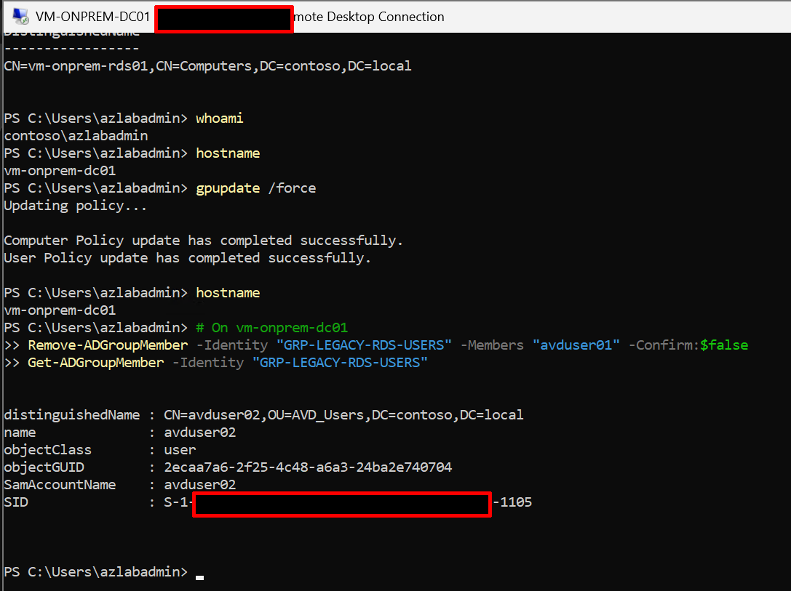
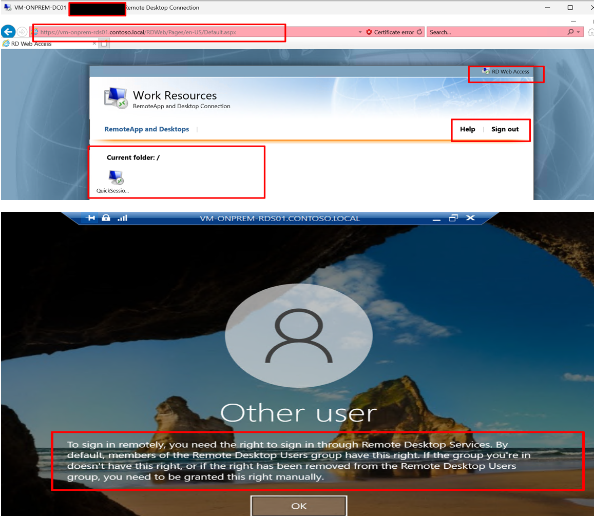

# Phase 6: Profile migration and user cutover

**Status:** Completed. The intended migration tool (`frx copy-profile`) failed
specifically against the legacy profile with a well-isolated, partially-unresolved
error; a manual file-copy fallback was used for the actual migration. Cutover
succeeded but required discovering and correcting a real group-scoping gap — the
group originally used for legacy RDS logon rights was the same group also used for
AVD access, which would have broken AVD access if cutover had been done naively. Full
diagnostic detail in `docs/phase-15-troubleshooting/README.md`, Issues 8 and 9.


## Objective

Migrate `avduser01`'s legacy roaming profile data into their FSLogix container, prove the data survives into a live AVD session, then cut off legacy RDS access without
breaking AVD access.

## Deviations from the original plan

1. **`frx copy-profile` failed specifically against the legacy profile, with a clean
   A/B control proving it wasn't a general FSLogix/SMB/corruption issue.** A parallel
   test against a clean, non-legacy profile (`FRXTEST_cleanprofile.vhdx`) succeeded
   without issue using the identical command and environment. The failure was
   isolated specifically to the legacy `avduser01.V6` profile's registry-export step
   (`0x00000001`, "Incorrect function"), not to file access, SMB, Azure Files, or
   FSLogix installation — all of which were independently confirmed working. See
   Phase 15, Issue 8, for the full isolation work.

2. **Manual file-copy was used as the actual migration path** instead of `frx`. Test
   files from the legacy profile were copied directly into `avduser01`'s working
   FSLogix VHDX (mounted via `Mount-DiskImage`) and confirmed present in a live AVD
   session.

3. **The originally planned cutover step (`Remove-ADGroupMember` from "Remote Desktop
   Users") did not actually block access.** `avduser01` remained able to sign into
   the legacy RDS farm afterward. Investigation found the real gate was a GPO-level
   user right (`SeRemoteInteractiveLogonRight`, "Allow log on through Remote Desktop
   Services"), granted to `GRP-AVD-USERS` — the **same group** also used for AVD
   application-group access (confirmed via `Get-AzRoleAssignment`). A naive fix
   (removing `avduser01` from `GRP-AVD-USERS`) would have cut AVD access too.

4. **A new, dedicated group (`GRP-LEGACY-RDS-USERS`) was created** to hold the
   RDS-logon-only right, separate from `GRP-AVD-USERS`. The GPO (Default Domain
   Policy, which governs `vm-onprem-rds01` — confirmed via `Get-ADComputer`, which
   sits in the default `CN=Computers` container, not `Domain Controllers`) was
   updated to grant the right to this new group instead.

5. **A related entry on Default Domain Controllers Policy was also found** granting
   `GRP-AVD-USERS` the same right on `vm-onprem-dc01` itself — a stray leftover from
   earlier Phase 1 troubleshooting, with no legitimate reason for regular users to
   have RDS rights to the domain controller. This was removed. During that edit, the
   policy's value was inadvertently overwritten rather than appended to, which
   temporarily locked out RDP/Bastion access entirely (including for `azlabadmin`).
   This was recovered via Azure Serial Console → SAC → a cmd/PowerShell channel,
   editing the security policy directly and reapplying it with `secedit`. Full detail
   in Phase 15, Issue 9.

## Steps actually run

1. Confirmed legacy profile data existed in `\\vm-onprem-dc01\legacy-profiles\avduser01.V6`
   (note: the actual current folder is `.V6`, not `.V2` as originally planned — Windows
   auto-increments the roaming profile version folder over time; this is expected
   Windows behavior, not an error).

2. Took ownership of the legacy profile folder (`takeown` / `icacls`) to read its
   contents, since roaming profile folders are NTFS-locked to the owning user by
   default, independent of share-level permissions.

3. Attempted `frx copy-profile` — failed at the registry-export stage. Ruled out
   SMB/file access, hive readability (`reg load`/`reg export` both succeeded
   independently), and general FSLogix function (clean-profile control test
   succeeded) as causes.

4. Used the manual fallback: mounted `avduser01`'s existing FSLogix VHDX directly via
   `Mount-DiskImage`, copied legacy test files into it, confirmed via a live AVD
   sign-in that the files were present on the Desktop.

5. Attempted cutover via Remote Desktop Users group removal — did not block access;
   investigated and found the actual gate was a GPO user right tied to `GRP-AVD-USERS`.

6. Created `GRP-LEGACY-RDS-USERS`, added both `avduser01` and `avduser02` (since
   `avduser02` has not yet been individually migrated/cut over).

7. Updated Default Domain Policy to grant `SeRemoteInteractiveLogonRight` to the new
   group instead of `GRP-AVD-USERS`; removed the stray grant from Default Domain
   Controllers Policy entirely.
   
8. Removed `avduser01` specifically from `GRP-LEGACY-RDS-USERS`.
   
9.  Confirmed via RDWeb: `avduser01` authenticates successfully at the web portal
   layer, then is correctly denied at the RDP/session-host authorization stage —
   the expected, correct behavior for a `SeRemoteInteractiveLogonRight`-based block.

## Verification

```powershell
# Confirm avduser01 is removed from the legacy-access group, avduser02 remains
Get-ADGroupMember -Identity "GRP-LEGACY-RDS-USERS"
# Expect: only avduser02 listed

# Confirm the GPO targets the correct group
# (run on vm-onprem-rds01, which is governed by Default Domain Policy --
# confirmed via Get-ADComputer showing CN=Computers, not Domain Controllers)
secedit /export /cfg C:\secpol-check.cfg /areas USER_RIGHTS
Select-String -Path C:\secpol-check.cfg -Pattern "SeRemoteInteractiveLogonRight"
# Expect: GRP-LEGACY-RDS-USERS, not GRP-AVD-USERS

# Confirm avduser01's AVD access is untouched (still via GRP-AVD-USERS)
Get-AzRoleAssignment -ResourceGroupName "rg-avd-prod-centralindia-001" `
    -ResourceName "ag-avd-desktop-01" -ResourceType "Microsoft.DesktopVirtualization/applicationgroups" |
    Where-Object { $_.DisplayName -eq "GRP-AVD-USERS" }
```

**Actual cutover behavior confirmed:**
```
Internet Explorer → RDWeb URL → RDWeb authentication succeeds →
Quick Session Workspace → click Quick Session →
Windows/RDP authentication prompt → ❌ Access denied
```
This confirms the denial happens at the RDP/session-host authorization stage, *after*
RDWeb's own authentication — exactly the expected behavior when
`SeRemoteInteractiveLogonRight` is the controlling mechanism, rather than a
front-door account lockout.

## Evidence checklist 

- [x] 
   
- [x] 
  
- [x] 
  
- [x] 
   
- [x] 
  
- [x]  
  
- [x] **[frx-copy-profile-failure.txt](../evidence/frx-copy-profile-failure.txt)**
  
- [x] **[groupmembership-final.txt](../evidence/groupmembership-final.txt)**
  

## Outcome

Phase 6 completed with a genuinely useful structural finding: the original design used a single AD group (`GRP-AVD-USERS`) for two distinct purposes — AVD application access and legacy RDS logon rights — which meant a naive per-user cutover would have broken the wrong thing. Splitting this into `GRP-AVD-USERS` (AVD-only) and `GRP-LEGACY-RDS-USERS` (legacy-RDS-only) is a better design than the original plan, discovered through the cutover attempt itself rather than anticipated in advance. 

The`frx copy-profile` failure against the legacy profile specifically remains only partially root-caused — isolated to the registry-export stage via a clean A/B control, but the exact cause within that stage was not determined before the manual fallback was used instead. This is documented honestly as a known, bounded limitation rather than a fully solved problem.
