# Phase 7: App Attach

**Status:** Completed. "MSIX App Attach" was deprecated by Microsoft in June 2025 —
the current feature is simply "App Attach," with CimFS (.cim) as the now-recommended
image format over VHDX. This project attempted CIM first (per current Microsoft
guidance), hit a specific, documented, OS-version-related mounting failure, and
pivoted cleanly to VHDX — which Microsoft's own documentation offers as the explicit
fallback for exactly this failure. Full diagnostic detail in
`docs/phase-15-troubleshooting/README.md`, Issue 10.

**Est. time:** significant — packaging, signing, two image-format attempts, and a
portal bug workaround all added real time beyond a first-attempt estimate.
**Est. cost:** minimal (no new paid resources beyond existing storage/compute).

## Objective

Package a real application (Notepad++) as MSIX, convert it to an App Attach image,
deliver it to a user without installing it locally, and prove it is not a permanent
local install.

## Deviations from the original plan

1. **CIM (Microsoft's current recommended format) failed with a specific, documented
   error:** `Error expanding msix app attach package... Native error when mounting
   CIM, HResult -2147024809, ErrorCode 87` (= `0x80070057`, `ERROR_INVALID_PARAMETER`).
   Confirmed via web search against Microsoft Tech Community and independent sources
   as a known issue tied to CIM version mismatch between the packaging OS (Windows 11,
   V3 CIM) and session host OS, and/or a missing cumulative update
   (KB5060829, June 2025). Extensive isolation was done: Azure Files reachability
   (TCP 445, `Test-Path`, SYSTEM access) all confirmed working; CimFS and WCIFS
   drivers confirmed present and running; `VirtualMachinePlatform`/Containers
   features confirmed correctly disabled; local CIM mount via the `CimDiskImage`
   PowerShell module tested directly and also failed, with a related but distinct
   error (`298`, "Too many posts were made to a semaphore"). CIM was abandoned as not
   worth further time, in favor of the documented VHDX fallback.

2. **Pivoted to VHDX**, using the same signed `.msix`, via
   `msixmgr -fileType vhdx` instead of `-fileType cim`. Succeeded on first attempt.
   Integrity verified by computing SHA256 on both the local file and the Azure
   Files copy — confirmed byte-for-byte identical before proceeding.

3. **Azure Portal's App Attach package creation failed** with a generic, unhelpful
   error ("Failed to create app attach undefined," clicking through led to a generic
   Resource Not Found page). Bypassed via PowerShell directly —
   `Import-AzWvdAppAttachPackageInfo` then `New-AzWvdAppAttachPackage` — both
   succeeded cleanly where the portal did not.

4. **Signing required a specific, older `signtool.exe` version.** The Windows SDK's
   newest `signtool` (10.0.28000.0) refused to sign the MSIX ("This file format
   cannot be signed because it is not recognized"). An older version
   (10.0.18362.0) signed it successfully. Worth knowing if re-attempting on a
   different machine with a different SDK version installed.

5. **Packaging was done entirely on a local laptop, not on `vm-avd-host-0`.** The
   signing certificate was deliberately *not* installed on the packaging machine —
   only the session host needs to trust it, since that's where the signature is
   actually validated at mount/launch time. This separation was correctly maintained
   throughout.

6. **A locally-installed copy of the real Notepad++ package** (not the App Attach
   one) was found alongside the App Attach package during final verification —
   leftover from an earlier step where the package was briefly registered with
   `-AllowUnsigned` just to read its Publisher field from the manifest. Cleaned up
   via `Remove-AppxPackage`, confirmed gone in a follow-up check.

7. **`avduser01` could not sign in** to test the final result (a "blue background"
   login error on the AVD web client, in incognito mode) — unrelated to this phase's
   cutover work (`avduser01`'s AVD-access group, `GRP-AVD-USERS`, was confirmed
   still intact). `avduser02` was used instead for the successful end-to-end test.
   `avduser01`'s specific sign-in issue was not investigated further and remains a
   loose end — noted, not resolved.

## Steps actually run

1. Downloaded Notepad++'s installer (`.exe`, not `.msix` — not available in MSIX
   form directly from the vendor).

2. Used Microsoft's **MSIX Packaging Tool** (Microsoft Store app) to convert the
   `.exe` installer into a real `.msix`, with Package name `NotepadPlusPlus-x64`
   and Publisher `CN=AVD-Lab-MSIX` (both required specific formatting — the tool
   rejected spaces and special characters in these two fields specifically).

3. Created a self-signed certificate (`CN=AVD-Lab-MSIX`) via
   `New-SelfSignedCertificate`, targeting `Cert:\LocalMachine\My` (not
   `Cert:\CurrentUser\My`, which failed with `SEC_E_DELEGATION_REQUIRED` under a
   remote/domain session context).

4. Exported PFX and CER; signed the `.msix` with `signtool.exe` 10.0.18362.0;
   verified the signature.

5. Converted the signed `.msix` into both a CIM (failed, see Deviation 1) and then a
   VHDX (succeeded) via `msixmgr`.

6. Copied the VHDX to the `msix-apps` share; verified SHA256 integrity match between
   local and uploaded copies.

7. Imported the signing certificate's `.cer` into `vm-avd-host-0`'s
   `Cert:\LocalMachine\Root` store (the session host, not the packaging laptop).

8. Created the App Attach package via PowerShell (portal failed — see Deviation 3):
   `notepadplusplus-avdlab`, Active, On-demand registration.

9. Associated the package with `hp-avd-prod-01`.
    
10. Assigned the package to users via the portal.
    
11. Confirmed live, working end-to-end: `avduser02` signed in, Notepad++ appeared
    and launched.

12. Confirmed via `Get-AppxPackage -AllUsers` that the only remaining Notepad++
    package is the App Attach one (`NotepadPlusPlus.AVDLab`), correctly attributed
    to `avduser02`'s session — the earlier stray local-install copy was removed.

## Verification

```powershell
# Confirm the App Attach package state
Get-AzWvdAppAttachPackage -ResourceGroupName "rg-avd-prod-centralindia-001" -Name "notepadplusplus-avdlab"
# Expect: HostPoolReference populated with hp-avd-prod-01, ImageIsActive = True

# Confirm it's delivered via App Attach, not locally installed
Get-AppxPackage -AllUsers | Where-Object { $_.Name -like "*NotepadPlusPlus*" }
# Expect: ONLY NotepadPlusPlus.AVDLab (Publisher CN=AVD-Lab-MSIX), attributed to
# the test user's session — no second, locally-installed copy
```

**Actual confirmed result:**
```
Name: NotepadPlusPlus.AVDLab
Publisher: CN=AVD-Lab-MSIX
Version: 8.8.8.0
PackageUserInformation: {...avduser02 [CONTOSO\avduser02]: Installed}
Status: Ok
```

## Evidence checklist 


- [x] 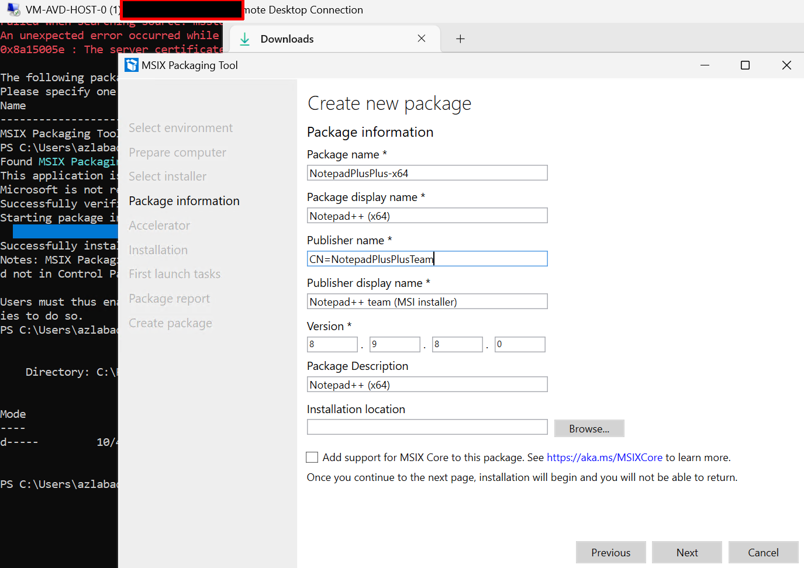
  
- [x] 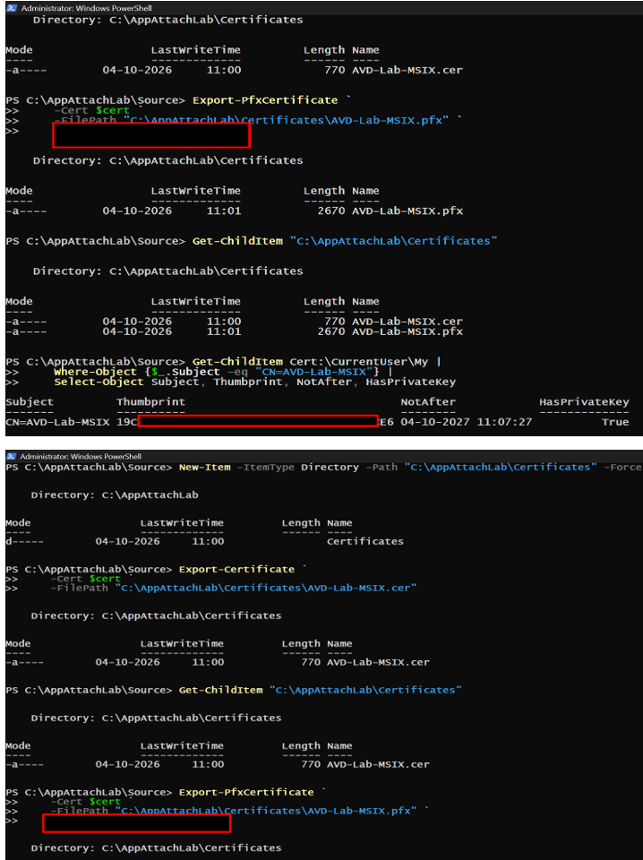
  
- [x] 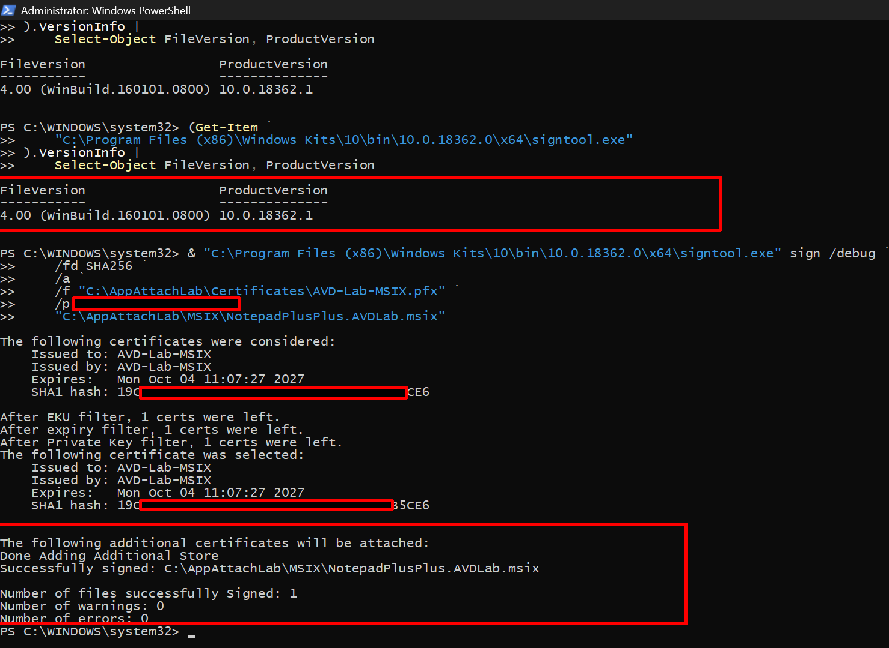
   
- [x] 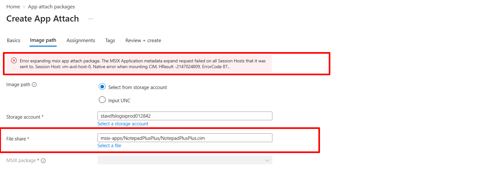
  
- [x] 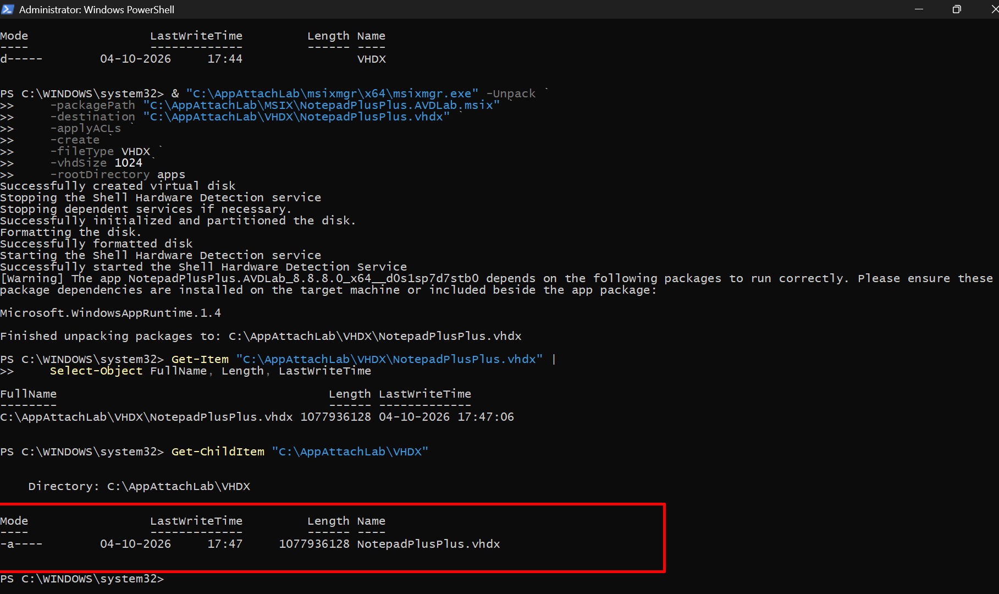
  
- [x] 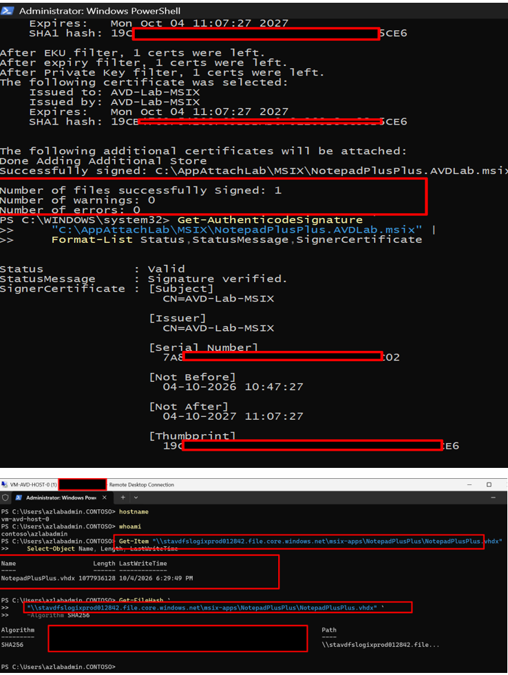
  
- [x] 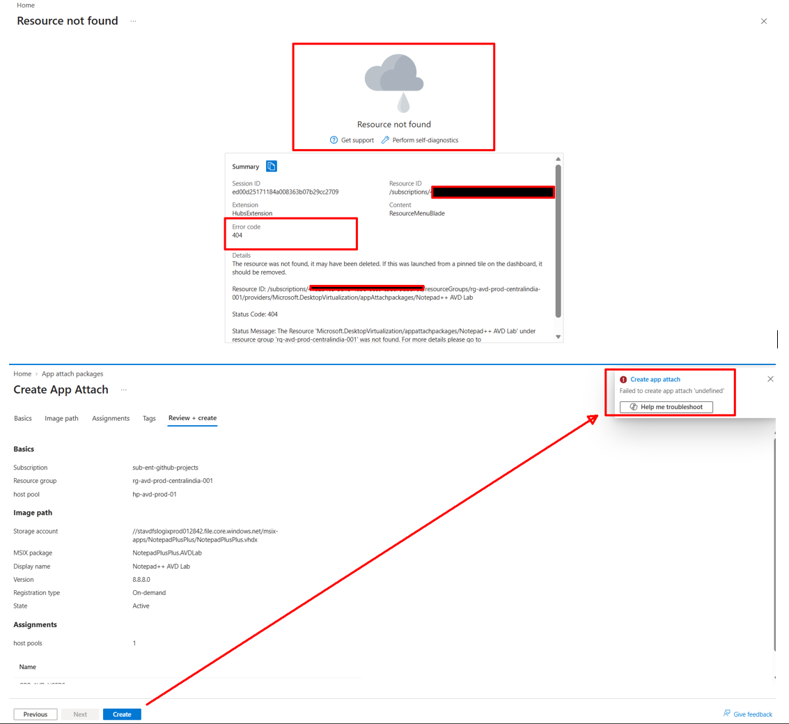
   
- [x] 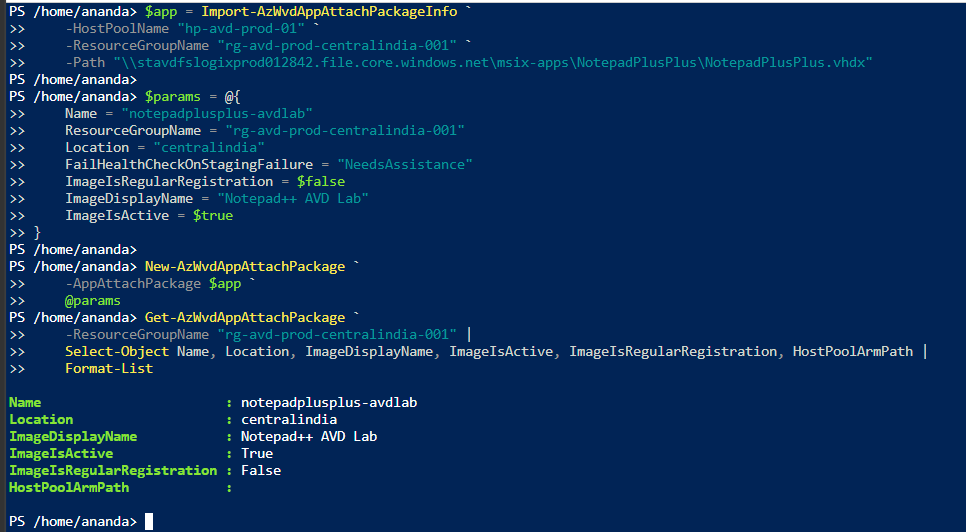
  
- [x] 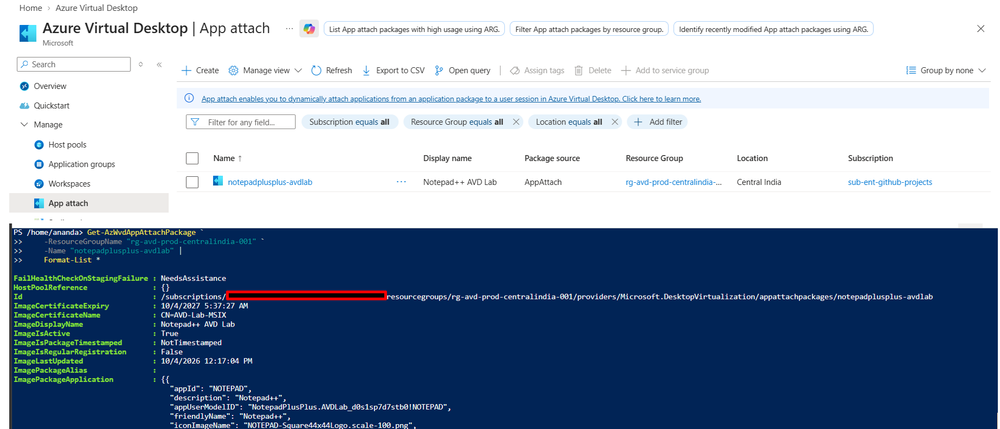
  
- [x] 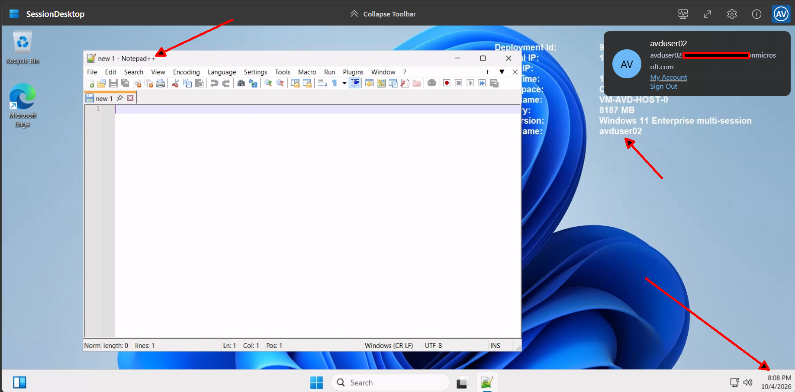
  
  
- [x] 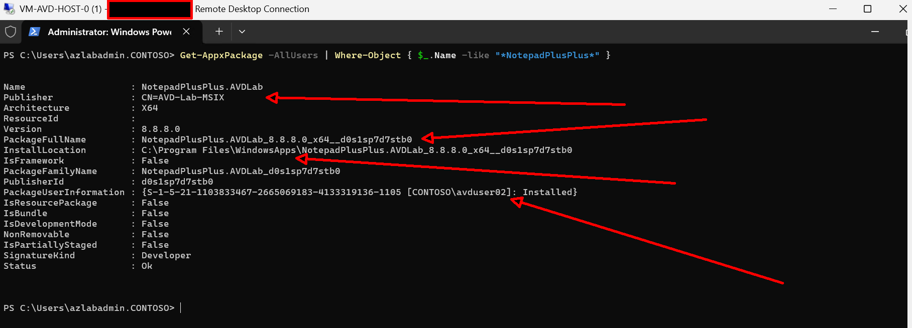
  
- [x] **[full CIM error text and the diagnostic checks that ruled out network/driver/feature causes](../evidence/phase7-appattach-evidence.txt)**
  
- [x] **[both SHA256 hash outputs, local and uploaded](../evidence/phase7-vhdx-sha256-verification.txt)**

- [X] **[final `Get-AzWvdAppAttachPackage` and `Get-AppxPackage` output](../evidence/phase7-appattach-package-final-state.txt)**


## Outcome

Phase 7 completed successfully end-to-end, via VHDX rather than the currently-recommended CIM format, due to a specific, documented, well-isolated mounting incompatibility. ***This is a legitimate, documented fallback*** — Microsoft's own community resources confirm this exact error and offer VHDX as the standard workaround — not an unresolved gap. 

The portal's own App Attach creation flow was found to be broken in this environment and was bypassed cleanly via PowerShell.