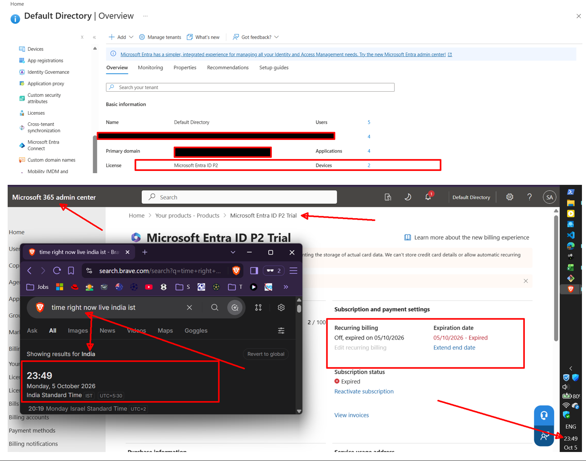
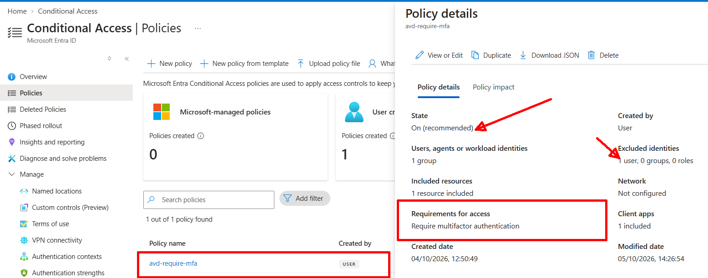
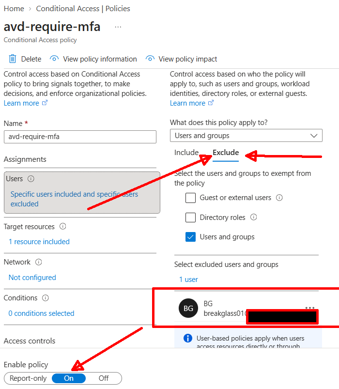
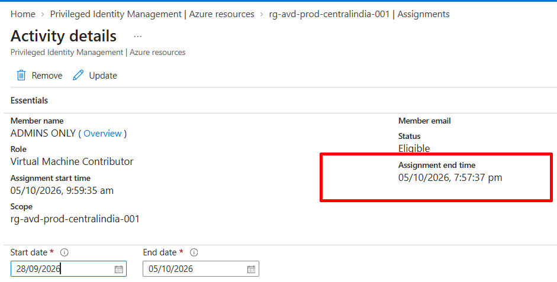
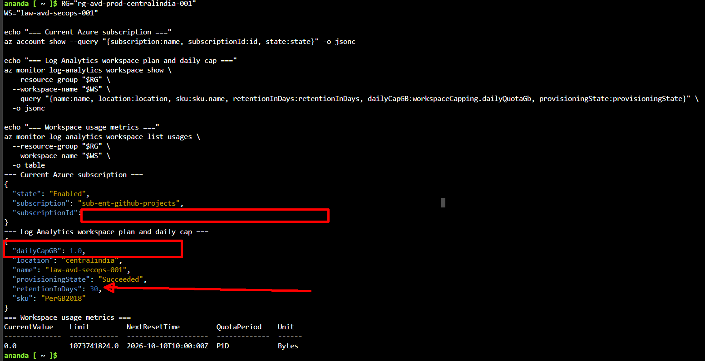
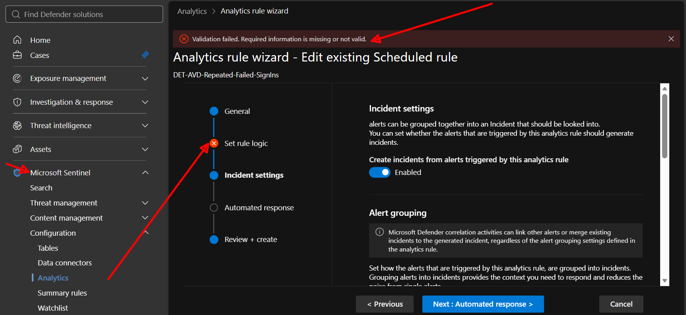
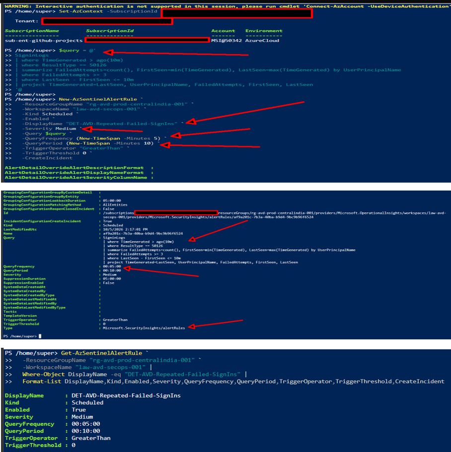
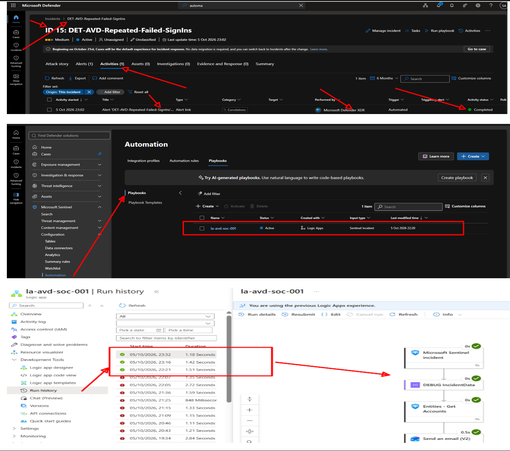

# Phase 8: P2, Conditional Access, PIM, and Sentinel SIEM/SOAR

**Status:** Done — started on the last day of the Entra ID P2 trial.
Priority order below is deliberate: P2-dependent steps (1-7) come before the
optional SOAR/Logic App layer (step 8), since the latter is not P2-gated and
can be completed after the trial expires if time runs short.

## Objective

Protect the AVD environment with Entra ID P2 controls (Conditional Access MFA,
PIM just-in-time admin access) and demonstrate a complete Sentinel SIEM workflow: ***detection → incident → automated triage → disposition*** — not just
log collection.

## Why this expanded beyond the original plan

The original Phase 8 scope was Conditional Access, PIM, and a single Sentinel analytics rule. It was expanded to include a Logic App SOAR playbook andautomation rule, so the phase demonstrates the full detect → triage → classify → respond loop rather than stopping at "an alert fired." 

This is a deliberate scope increase, made consciously against the time cost.

## Prerequisites

- Phases 1-7 complete.
- **Activate the P2 trial and screenshot the exact expiry timestamp before
  anything else** — this is evidence item 01, and it's also how you'll know
  your real deadline for steps 1-7.
- Create a break-glass cloud-only account **before** any Conditional Access
  policy. Exclude it from every policy. Never record its real UPN in any
  committed file — refer to it only as "the break-glass account."

## Steps

### Core (P2-dependent, do first)

1. **Log Analytics workspace** `law-avd-secops-001`, daily cap 1 GB (scripted
   — see `scripts/phase-8.ps1`). The cap isn't a realistic production SIEM
   budget; it's an explicit, visible cost-control boundary for this lab.
2. **Enable Sentinel** on that workspace (portal).
3. **Data connectors**: Entra ID sign-in logs, Azure Activity, Windows
   Security Events via Azure Monitor Agent with a **scoped** Data Collection
   Rule — "Common" event set, not "All Events." Collect what the detection
   needs, not everything available.
4. **Conditional Access**: policy `CA-AVD-Require-MFA`, users = `GRP-AVD-USERS`
   or one test user, exclude break-glass, target resource = Azure Virtual
   Desktop, grant = require MFA. Report-only first, validate against sign-in
   logs, then switch to On.
5. **PIM**: `Virtual Machine Contributor` role (narrowly scoped — not a
   powerful role for a lab demo), scope = `rg-avd-prod-centralindia-001`,
   assignment type = Eligible. Activate once for evidence.
6. **Detection rule** `DET-AVD-Repeated-Failed-SignIns` — scheduled KQL query
   (full text in `scripts/phase-8.ps1`), runs every 10-15 min, threshold ≥5
   failed attempts in a 10-min window creates an incident.
7. **Trigger it**: generate 5+ deliberate failed sign-ins against the test
   account only — not a real attack, a controlled simulation. Wait for the
   scheduled rule, confirm an incident appears in Sentinel.

**← Checkpoint. If the P2 trial is about to expire, stop here — everything
above is independently complete and evidenced.**

### SOAR layer (optional, not P2-gated)

8. **Logic App** `la-avd-soc-001`, playbook `PB-AVD-FailedSignIn-Triage`,
   triggered by the Sentinel incident connector. Workflow: parse incident
   fields → compose a real, informative notification (not just "incident
   created" — include incident ID, detection name, user, failed-attempt
   count, observed IPs, severity) → send it (whatever connector you already
   have — email, Teams) → add an incident comment documenting this as a
   controlled SOC simulation, not a real attack → tag
   `SOC-Simulation`/`MITRE-T1110`/`FalsePositive-Test`/`AVD-Lab` → close the
   incident with a False Positive classification.
9. **Automation rule** `AUTO-AVD-FailedSignIn-SOAR`: trigger = incident
   created, condition = analytics rule name matches step 6's rule, action =
   run the step 8 playbook.

## Evidence checklist

- [X] 
  
- [x] 
  
- [x] 
  
- [x] 
  
- [x] 
  
- [x] 
  
- [x] 
  
- [x] 
  
- [x] **[conditional access mfa.json](../../conditional-access/avd-require-mfa.json)**
  
- [x] **[sentinel analytics rule](../../sentinel/analytics-rules/Azure_Sentinel_analytic_rule.json)**
   
- [x] **[automation rule](../../sentinel/playbooks/AUTO-AVD-FailedSignIn-SOAR.json)**

